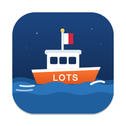
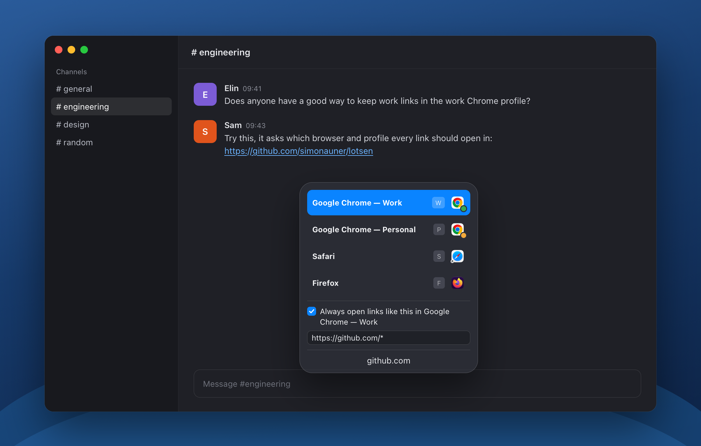
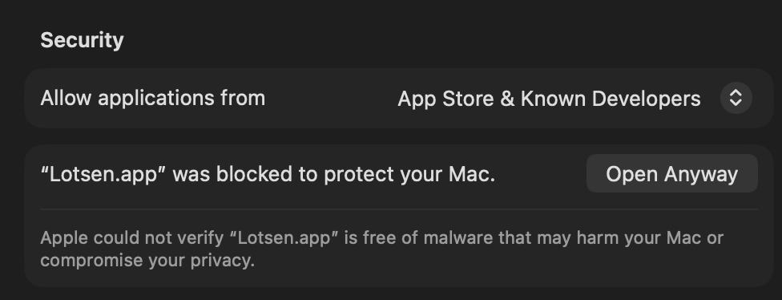

# Lotsen



Lotsen is a tiny browser selector for macOS written in SwiftUI. Set it as the default browser, assign shortcuts, and choose which app opens each link. Like a harbour pilot (*lots* in Swedish), it guides every link to the right place.

## Based on Browserino

Lotsen started as a fork of [Browserino](https://github.com/AlexStrNik/Browserino) by [Aleksandr Strizhnev](https://github.com/AlexStrNik), and most of what it does comes from Aleksandr's work and from the Browserino contributors. Browserino was in turn inspired by [Browserosaurus](https://github.com/will-stone/browserosaurus) by Will Stone. The fork was renamed once it had drifted far enough from the original that sharing a name would confuse people about which app they're running. It is not endorsed by the Browserino author, so please report Lotsen issues here rather than upstream.

On top of Browserino, Lotsen adds:

- **Browser profiles**: Chromium profiles show up as separate targets, with custom names, visibility and shortcuts (Browserino PRs [#48](https://github.com/AlexStrNik/Browserino/pull/48) by Moti Levy and [#65](https://github.com/AlexStrNik/Browserino/pull/65) by Matija Zezelj).
- **Move current tab**: send the open tab to another browser from the menu bar or a global shortcut ([#61](https://github.com/AlexStrNik/Browserino/pull/61) by Lukas Wolfsteiner).
- **Missing apps** stay visible and editable instead of disappearing ([#63](https://github.com/AlexStrNik/Browserino/pull/63) by Matija Zezelj).
- **Localization** in ten languages, with a manual language picker.
- **Rules**: write a rule as a simple wildcard pattern such as `https://example.com*` instead of a regex, and check it against example URLs in Test URLs.
- **Modern macOS**: Swift 6, macOS 14 minimum ([#64](https://github.com/AlexStrNik/Browserino/pull/64) by Matija Zezelj), Liquid Glass on macOS 26 and builds with the Xcode 27 SDK.

### Thanks to the Browserino contributors

Several of these features started as pull requests to Browserino that are still open there. Lotsen builds on that work, so the credit for it goes to:

- [Matija Zezelj](https://github.com/matijazezelj) for opening links in a specific Chromium profile ([#65](https://github.com/AlexStrNik/Browserino/pull/65)), Swift 6 and the macOS 14 baseline ([#64](https://github.com/AlexStrNik/Browserino/pull/64)), and keeping rules working when their target app is uninstalled ([#63](https://github.com/AlexStrNik/Browserino/pull/63)).
- [Moti Levy](https://github.com/motilevy) for Chrome profile support in the picker and rules ([#48](https://github.com/AlexStrNik/Browserino/pull/48)).
- [Lukas Wolfsteiner](https://github.com/dotWee) for moving the current tab to another browser ([#61](https://github.com/AlexStrNik/Browserino/pull/61)).
- [Ninad P. Chaudhari](https://github.com/ninadpchaudhari) for dropping the deprecated `--no-quarantine` flag from the install instructions ([#55](https://github.com/AlexStrNik/Browserino/pull/55)).

The [integration notes](docs/UPSTREAM_REVIEW.md) describe what was taken from each pull request and what changed along the way.

Each version is tagged, and its changes are listed under [Releases](https://github.com/simonauner/lotsen/releases). If you want the original app, install it from [the Browserino repository](https://github.com/AlexStrNik/Browserino#installation).

# Installation

### Homebrew

Install the app from the project's own tap:

```bash
brew install --cask simonauner/tap/lotsen
```

Requires macOS 14 or later. The download supports both Apple Silicon and Intel; Xcode is not needed. Open Lotsen from Applications, then select it in **System Settings → Desktop & Dock → Default web browser**. Update with:

```bash
brew update
brew upgrade --cask lotsen
```

Lotsen uses ad hoc signing and is **not notarized by Apple**. If macOS blocks the first launch, try opening the app, then use **System Settings → Privacy & Security → Open Anyway** if you trust the download. See [Apple's instructions](https://support.apple.com/en-gb/102445). Managed Macs may not allow this exception.



If you previously installed Lotsen from source, quit it and move `/Applications/Lotsen.app` to the Trash before installing the cask. Your preferences are stored separately and are preserved.

### Build from source

Requirements: macOS 14 or later and Xcode (the Command Line Tools alone can't build apps).

```bash
git clone https://github.com/simonauner/lotsen.git
cd lotsen
./scripts/install-local.sh
```

The script builds Lotsen, ad-hoc signs it, installs it to `/Applications` and launches it, replacing any running copy. Then pick Lotsen as the default browser in **System Settings → Desktop & Dock → Default web browser**.

### Coming from Browserino

On first launch Lotsen copies your Browserino settings (browsers, apps, rules, shortcuts and language), so nothing needs to be set up again. Links that use the old `browserino://` scheme keep working. Launch at login has to be turned on again in General.

Then uninstall Browserino so the two apps don't compete as the default browser. If you installed it with Homebrew:

```bash
brew uninstall --cask browserino
```

To update a source installation, pull and run the script again:

```bash
git pull && ./scripts/install-local.sh
```

Because the app is built on your own machine it has no quarantine flag, so Gatekeeper doesn't block it on first launch.

If you want to support Browserino's author, you can buy Browserino on [Gumroad](https://alexstrnik.gumroad.com/l/browserino).

## Languages

The interface supports English, Russian, German, French, Spanish, Brazilian Portuguese, Italian, Japanese, Korean and Simplified Chinese. Lotsen follows the macOS preferred language order and falls back to English. Choose a language manually in General > Language, or select System default; changes take effect immediately and persist across launches. Translations are maintained in `Lotsen/Localizable.xcstrings` with semantic keys such as `settings.language.title`; displayed text belongs in the language values.

Validate translation coverage with `python3 scripts/check-localizations.py`.

## Browser profiles and tab transfer

Requires macOS 14 or later. The selector uses Liquid Glass on macOS 26 and later.

Chromium profiles appear in Browsers. Use Enable profiles to grant access to the browser data folder when macOS requires it. Profile names, visibility, shortcuts and rule/app destinations can be customized. Turning off profile display preserves those preferences.

Use Move current tab from the menu bar or assign its global shortcut in General. Allow Automation only for the browser you want to control. Closing the original is optional and disabled by default; Safari keeps its source tab open. Chromium closing requires the same original tab/window IDs and URL. Application launch success does not confirm that the destination page finished loading.

The selector also offers profiles in the source browser. When opening in a profile of the same browser, the original tab stays open because its source profile cannot be identified reliably. Enable profile display in Browsers to use these destinations.

### Rules and one-time exceptions

Hold Option while opening a link to skip automatic rules for that opening and show the selector. Pause automatic rules from the menu bar or in Rules settings; turn the same option off to resume. The pause survives relaunching Lotsen and leaves saved rules intact.

Choosing a private window with “Always open” saves private mode with the rule. Private rules show a lock in Rules, where “Open in Private Window” can be changed. Older rules continue to open normally. Private opening must be supported by the destination browser.

Browser authentication sessions may still require Safari. Both local development builds and downloadable releases use ad hoc signing without Apple notarization.

## Local development

`./scripts/install-local.sh` builds a Release build by default. The app icon is drawn in `images/icon/AppIcon.svg`; run `./scripts/build-icons.sh` after editing it to regenerate `Lotsen/Lotsen.icns` and the logo above. Set `CONFIGURATION=Debug` for a debug build; the build log is written to `build/xcodebuild.log`.

Browserino attribution and validation notes: [integration review](docs/UPSTREAM_REVIEW.md). KeyboardShortcuts is licensed under MIT; its notice is bundled with the app.

## License

Lotsen is free software under the [GNU General Public License v3](LICENSE), the same license as Browserino. Browserino is copyright © 2024 Aleksandr Strizhnev; the changes in Lotsen are copyright © 2026 Simon Aunér.
